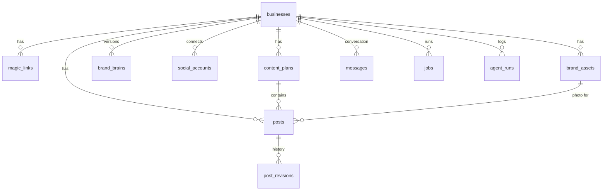

# Data model

Postgres on Supabase ([ADR 0003](../decisions/0003-database-supabase-sqlalchemy.md)). The schema below is the **initial Alembic migration** (`backend/migrations/versions/0001_initial.py`, executing this SQL). After that, every change is a new migration; never edit an applied one.

Conventions follow [`.claude/rules/database.md`](../../.claude/rules/database.md): explicitly named constraints and indexes (`uq_`, `ck_`, `ix_`, `{table}_{col}_fkey`), every FK column indexed (or covered by a composite index or unique constraint that starts with it), `timestamptz` everywhere, enum-like values as `text` + `check`, JSON in `jsonb`. Primary keys are UUIDs rather than identity integers, because IDs travel in WhatsApp button payloads and URLs (see the ADR).

## Entity overview



## Schema

```sql
create extension if not exists pgcrypto;

-- One row per Business (= one Owner phone number in the MVP)
create table businesses (
  id                 uuid primary key default gen_random_uuid(),
  owner_phone        text not null,                  -- E.164 without '+', as WhatsApp sends it: "59899123456"
  owner_name         text,                           -- WhatsApp profile name
  name               text,
  category           text,
  one_liner          text,
  description        text,
  location           text,
  website            text,
  instagram_handle   text,
  timezone           text not null default 'America/Montevideo',
  onboarding_state   text not null default 'new',
  onboarding_data    jsonb not null default '{}',    -- raw wizard answers: products, questionnaire, 3 words, colors
  conversation_state jsonb not null default '{}',    -- {"awaiting": "post_feedback", "post_id": "..."}
  channel            text not null default 'whatsapp',
  plan               text not null default 'free',   -- future billing
  monthly_post_quota int  not null default 30,       -- future billing, not enforced
  created_at         timestamptz not null default now(),
  updated_at         timestamptz not null default now(),
  constraint uq_businesses_owner_phone unique (owner_phone),
  constraint ck_businesses_onboarding_state check (onboarding_state in
    ('new','awaiting_name','awaiting_web_form','generating_brand','awaiting_brand_confirmation','active')),
  constraint ck_businesses_channel check (channel in ('whatsapp','simulator')),
  constraint ck_businesses_monthly_post_quota_non_negative check (monthly_post_quota >= 0)
);

create table magic_links (
  id           uuid primary key default gen_random_uuid(),
  business_id  uuid not null constraint magic_links_business_id_fkey references businesses(id) on delete cascade,
  token_hash   text not null,                         -- sha256(token); the raw token only lives in the URL
  purpose      text not null default 'onboarding',
  expires_at   timestamptz not null,
  completed_at timestamptz,
  created_at   timestamptz not null default now(),
  constraint uq_magic_links_token_hash unique (token_hash),
  constraint ck_magic_links_purpose check (purpose in ('onboarding','dashboard'))
);
create index ix_magic_links_business_id on magic_links (business_id);

create table brand_assets (
  id            uuid primary key default gen_random_uuid(),
  business_id   uuid not null constraint brand_assets_business_id_fkey references businesses(id) on delete cascade,
  kind          text not null,
  source        text not null,
  storage_path  text not null,                        -- in bucket 'assets'
  mime_type     text not null,
  width         int,
  height        int,
  owner_hint    text,                                 -- optional label from the Owner
  analysis      jsonb,                                -- AssetAnalysis (null until analyzed)
  palette       jsonb,                                -- ["#2f3e2c", ...] (logos, Pillow)
  created_at    timestamptz not null default now(),
  constraint ck_brand_assets_kind check (kind in ('logo','photo')),
  constraint ck_brand_assets_source check (source in ('web','whatsapp'))
);
create index ix_brand_assets_business_id_kind on brand_assets (business_id, kind);

create table brand_brains (
  id           uuid primary key default gen_random_uuid(),
  business_id  uuid not null constraint brand_brains_business_id_fkey references businesses(id) on delete cascade,
  version      int  not null,
  data         jsonb not null,                        -- BrandBrain
  reason       text not null,
  created_at   timestamptz not null default now(),
  constraint uq_brand_brains_business_id_version unique (business_id, version),
  constraint ck_brand_brains_reason check (reason in ('onboarding','correction','chat_update')),
  constraint ck_brand_brains_version_positive check (version > 0)
);

create table social_accounts (
  id                   uuid primary key default gen_random_uuid(),
  business_id          uuid not null constraint social_accounts_business_id_fkey references businesses(id) on delete cascade,
  platform             text not null,
  provider             text not null,                 -- 'mock' | 'zernio'
  provider_profile_id  text,                          -- the provider's id for this Business
  provider_account_id  text,                          -- the provider's id for the connected IG account
  handle               text,
  status               text not null default 'pending',
  created_at           timestamptz not null default now(),
  updated_at           timestamptz not null default now(),
  constraint uq_social_accounts_business_id_platform unique (business_id, platform),
  constraint ck_social_accounts_platform check (platform in ('instagram','facebook')),
  constraint ck_social_accounts_status check (status in ('pending','connected','error'))
);

create table content_plans (
  id           uuid primary key default gen_random_uuid(),
  business_id  uuid not null constraint content_plans_business_id_fkey references businesses(id) on delete cascade,
  week_start   date not null,
  status       text not null default 'generating',
  data         jsonb,                                 -- WeeklyPlan (items + whatsapp_text)
  notes        text,
  created_at   timestamptz not null default now(),
  updated_at   timestamptz not null default now(),
  constraint ck_content_plans_status check (status in
    ('generating','pending_approval','revising','approved','failed'))
);
create index ix_content_plans_business_id_week_start on content_plans (business_id, week_start);

create table posts (
  id                uuid primary key default gen_random_uuid(),
  business_id       uuid not null constraint posts_business_id_fkey references businesses(id) on delete cascade,
  plan_id           uuid constraint posts_plan_id_fkey references content_plans(id) on delete set null,
  plan_item_index   int,
  origin            text not null,
  platform          text not null default 'instagram',
  brief             text not null,                    -- plan item idea or Owner request
  status            text not null default 'generating',
  title             text,
  copy              jsonb,                            -- PostCopy
  render_spec       jsonb,                            -- RenderSpec
  photo_asset_id    uuid constraint posts_photo_asset_id_fkey references brand_assets(id) on delete set null,
  image_path        text,                             -- in bucket 'renders'
  image_url         text,                             -- public URL
  revision          int  not null default 0,
  scheduled_for     timestamptz,
  approved_at       timestamptz,
  published_at      timestamptz,
  external_post_id  text,                             -- provider post id
  permalink         text,
  error             text,
  created_at        timestamptz not null default now(),
  updated_at        timestamptz not null default now(),
  constraint ck_posts_origin check (origin in ('plan','adhoc','photo')),
  constraint ck_posts_platform check (platform in ('instagram','facebook')),
  constraint ck_posts_status check (status in ('generating','pending_approval','revising','approved',
    'publishing','scheduled','published','failed','discarded')),
  constraint ck_posts_revision_non_negative check (revision >= 0),
  -- approval is enforced in code too, but no writer may mark a post published or scheduled without it
  constraint ck_posts_approved_before_publish check (
    status not in ('publishing','scheduled','published') or approved_at is not null)
);
create index ix_posts_business_id_status on posts (business_id, status);
create index ix_posts_plan_id on posts (plan_id);
create index ix_posts_photo_asset_id on posts (photo_asset_id);

create table post_revisions (
  id           uuid primary key default gen_random_uuid(),
  post_id      uuid not null constraint post_revisions_post_id_fkey references posts(id) on delete cascade,
  revision     int  not null,
  feedback     text,
  target       text,
  copy         jsonb,
  render_spec  jsonb,
  image_url    text,
  created_at   timestamptz not null default now(),
  constraint uq_post_revisions_post_id_revision unique (post_id, revision),
  constraint ck_post_revisions_target check (target in ('copy','image','both'))
);

create table messages (
  id              uuid primary key default gen_random_uuid(),
  business_id     uuid not null constraint messages_business_id_fkey references businesses(id) on delete cascade,
  direction       text not null,
  channel         text not null,
  external_id     text,                               -- wa_message_id (dedupe key for inbound)
  type            text not null,                      -- text | image | interactive | button_reply | audio | ...
  text            text,                               -- normalized text used in the LLM history
  payload         jsonb not null default '{}',        -- raw content (buttons, media ids, image url)
  status          text,                               -- outbound: sent | delivered | read | failed
  created_at      timestamptz not null default now(),
  constraint uq_messages_external_id unique (external_id),
  constraint ck_messages_direction check (direction in ('in','out')),
  constraint ck_messages_channel check (channel in ('whatsapp','simulator'))
);
create index ix_messages_business_id_created_at on messages (business_id, created_at desc);

create table jobs (
  id           uuid primary key default gen_random_uuid(),
  business_id  uuid constraint jobs_business_id_fkey references businesses(id) on delete cascade,
  kind         text not null,
  payload      jsonb not null default '{}',
  status       text not null default 'queued',
  result       jsonb,
  error        text,
  started_at   timestamptz,
  finished_at  timestamptz,
  created_at   timestamptz not null default now(),
  constraint ck_jobs_kind check (kind in ('analyze_asset','generate_brand','generate_plan',
    'generate_post','revise_post','publish_post')),
  constraint ck_jobs_status check (status in ('queued','running','succeeded','failed'))
);
create index ix_jobs_business_id on jobs (business_id);
create index ix_jobs_status_created_at on jobs (status, created_at);

create table agent_runs (
  id                uuid primary key default gen_random_uuid(),
  business_id       uuid constraint agent_runs_business_id_fkey references businesses(id) on delete cascade,
  job_id            uuid constraint agent_runs_job_id_fkey references jobs(id) on delete set null,
  agent             text not null,                    -- orchestrator | asset_analyst | brand_strategist | ...
  model             text not null,
  effort            text,
  input             jsonb,
  output            jsonb,
  stop_reason       text,
  input_tokens      int,
  output_tokens     int,
  cache_read_tokens int,
  latency_ms        int,
  error             text,
  created_at        timestamptz not null default now()
);
create index ix_agent_runs_business_id_created_at on agent_runs (business_id, created_at desc);
create index ix_agent_runs_job_id on agent_runs (job_id);
```

`updated_at` is set by the application on update (no triggers).

## Notes

- **Phone number = identity** in the MVP. Multi-user businesses later need `users` + `business_members`; nothing else in the schema assumes one owner except `businesses.owner_phone`.
- **Simulator businesses** use fake phone numbers prefixed `sim-` and `channel = 'simulator'`, so the outbound channel is chosen per business.
- **Row Level Security**: off for the hackathon (the backend uses the service role key and is the only DB client). Turn RLS on before any client talks to Supabase directly.
- **Seed**: `backend/app/db/seed.py` creates the demo business with a pre-generated Brand Brain and plan (see the demo fallbacks in [../product/mvp.md](../product/mvp.md#demo-fallbacks)).
